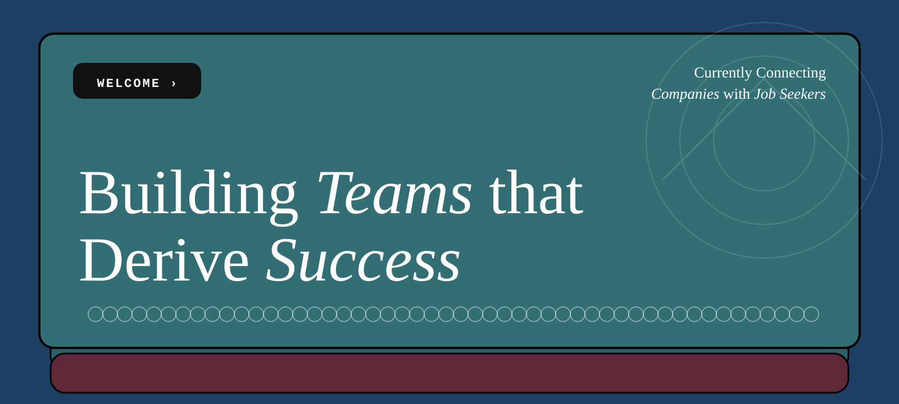
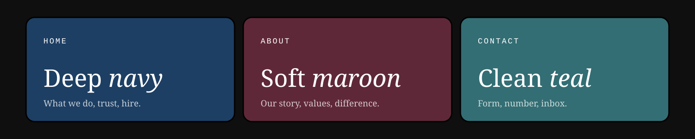

<div align="center">



### Building teams that derive success.

This is the website for **HR Masters** which serves as a recruitment and workforce consultancy helping companies across Saudi Arabia find and keep the right people.

[**Live site →**](https://hr-masters-ksa.vercel.app)

</div>

<br/>



## Three pages, three worlds

**Home** opens in deep navy. A wallet of cards stacked on top of each other where one is in front, and the others are peeking out from behind. This walks through exactly what the company does, the values that guide every placement, and the trust-and-why.

**About** switches to maroon. The wallet metaphor returns, but this time the cards *open*: click the chevron on any card and the whole layout breathes outward as the content expands.

**Contact** goes teal. A form, a phone number, an email, and nothing in the way.

Scroll inside a page and the sections snap. Switch pages and the color behind everything changes with you.

<br/>

> _Screenshots of the live pages belong here. Drop them into `docs/` and reference like:_
> `` · `` · ``

<br/>

## The look

Two typefaces do all the work.

**Rofane**, a tall-contrast serif, carries the headlines and the longer paragraphs. Its `unicode-range` is narrowed to Latin letters and digits on purpose so that anything outside that falls back cleanly instead of rendering half in-font and half out.

**Fake Receipt**, a chunky pixel display face, handles buttons, labels, and the retro accents. It's the thing that keeps the design from reading as another corporate SaaS page.

Everything else like spacing, color, and borders is kept quiet so those two faces can do the talking.

<br/>

## Stack

Vite + React for the shell. Framer Motion for the entrance animations and the scroll-linked fades. CSS scroll-snap for the section-by-section scroll. No UI library, no Tailwind, no CSS-in-JS as all plain CSS files are sitting next to each component. Deployed on Vercel.

<br/>

## Running it locally

```bash
git clone https://github.com/ahmedhassnain/hr-masters-ksa.git
cd hr-masters-ksa
npm install
npm run dev
```

Dev server at `localhost:5173`. For a production preview:

```bash
npm run build
npm run preview
```

<br/>

## Project layout

```
src/
├── App.jsx                 routes between pages, holds the color-scheme state
├── Navbar.jsx              page switcher + logo
├── Footer.jsx
├── Home.jsx                wallet hero, KPI carousel, trust dropdown, CTA
├── About.jsx               expanding wallet stack, values marquee, differentiators
├── Contact.jsx             form + contact details
├── Home-Components/
│   ├── CardComponent.jsx
│   ├── KPIComponent.jsx
│   ├── CardDropdown.jsx
│   └── FactCards.jsx
├── About-Components/
│   ├── KPICardAbout.jsx
│   └── AboutComponent.jsx
└── assets/                 fonts, wallet textures, bubble patterns
```

Framer Motion variants live at the top of each page file rather than in a shared config which is easier to tune per-section when they're sitting next to the JSX they drive.

<br/>

## A few decisions worth calling out

The scroll-snap container is `<html>` itself, not a wrapper div. Fixed-navbar variants were tried and created more awkwardness than they solved — the navbar scrolls with the first section and comes back when you scroll up to it.

`100vh` was replaced with `100dvh` after real iOS testing. Mobile Safari's URL bar changes the viewport height as you scroll, and the fixed `100vh` value left content hiding behind it.

Fonts are served from local `.otf` files, not Google Fonts. File names are lowercase with no spaces to avoid URL-encoding differences between local dev (macOS, case-insensitive) and Vercel's Linux runtime.

Card positions in the About wallet stack use `vh` units with a lookup table instead of hardcoded pixels, so the stack keeps its proportions across screen sizes without a media query per card.

<br/>

---

<div align="center">

Design and build by **[Ahmed Hassnain](https://github.com/ahmedhassnain)**

Rofane · Fake Receipt - used under their respective licenses.

</div>
